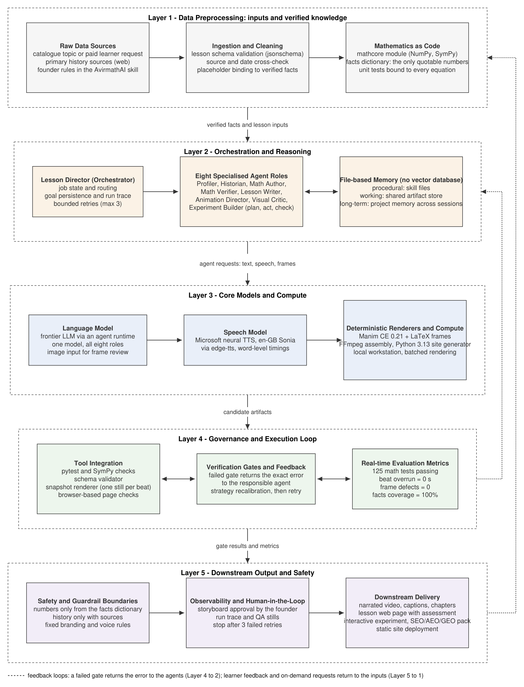

# AVIRMATH AI

**Open-source Ecosystem for the Mathematics behind AI.**
Founder and author: Gangadevi ([@gangadeviai](https://www.youtube.com/@gangadeviai))

AVIRMATH AI turns one lesson file into a narrated, captioned, chaptered animated video, a web
page and an SEO pack, with every number on screen produced by tested code. Six lessons are
published; the catalogue has twenty-one.

- **Website:** https://avirmath-site.vercel.app
- **Videos:** https://www.youtube.com/@gangadeviai
- **Architecture reference:** [docs/AVIRMATH_AI_Architecture.md](docs/AVIRMATH_AI_Architecture.md)
- **Plain-language explainer:** [docs/AVIRMATH_AI_Explained_Simply.md](docs/AVIRMATH_AI_Explained_Simply.md)
- **Verified results:** [RESULTS.md](RESULTS.md) · **Decisions:** [DECISIONS.md](DECISIONS.md)



## What is in this repository

| Folder | Contents |
|---|---|
| `lessons/` | The six published lesson files and the 21-topic catalogue. A lesson holds chapters, narration beats, equations and sources; numbers appear only as `{placeholders}`. |
| `src/avirmath/mathcore/` | The mathematics behind each lesson as plain NumPy/SymPy code, plus `lesson_facts()`, the only source of numbers a lesson may quote. Includes the credit, demand and dermatology models used on screen. |
| `src/avirmath/lesson/` | The lesson schema and loader: validates a lesson, binds placeholders to facts, and refuses an equation whose `checked_by` test does not exist. |
| `tests/` | 125 pytest tests: symbolic checks against SymPy, finite-difference gradient checks, model metrics and the demonstrated failure modes. |
| `data/` | The three UCI datasets modelled on screen (see `DATASETS.md`). |
| `docs/` | Architecture reference and plain-language explainer, with figures (PDF/SVG/PNG). |
| `results/` | Per lesson: chapter list, captions, description and the summary written for AI search. |
| `thumbnails/` | The published video thumbnails. |

## What stays private

The production pipeline is in a private repository: agent orchestration rules, narration
synthesis and timing, Manim scene code, the renderer with its per-beat QA, and the site
generator. The architecture documents describe all of it.

## Run the mathematics

```bash
python -m venv .venv
.venv/Scripts/pip install -e ".[test]"      # Linux/macOS: .venv/bin/pip
python -m pytest -q                          # 125 passed, about two minutes
```

```python
from avirmath.mathcore import softmax as sm
facts = sm.lesson_facts()
facts["derm_acc"], facts["derm_top2"], facts["derm_ece"]   # (97, 100, 0.018)
```

Validate a lesson file against the facts and tests:

```python
from avirmath.lesson.loader import load_lesson
lesson = load_lesson("softmax-cross-entropy")
print(lesson.title, len(lesson.beats), "beats")
```

## The lessons

| # | Lesson | What is modelled on screen |
|---|---|---|
| 1 | What Is Gradient Descent? | the lesson landscape, an LMS adaptive filter |
| 2 | What Is Backpropagation? | a two-layer network, gradients checked against SymPy |
| 3 | What Is a Vector, and What Is the Dot Product? | embeddings, cosine similarity, projection |
| 4 | Matrices in AI | a neural layer, attention as Q·Kᵀ, PageRank, low-rank adaptation (LoRA) |
| 5 | Softmax and Cross-Entropy in Machine Learning | six-class diagnosis on 366 dermatology patients; lung-cancer screening and GPT-2 as cited examples |
| 6 | Linear vs Logistic Regression in Machine Learning | credit risk on 1,000 German Credit applicants; hourly bike demand on 17,379 rows |

Every lesson follows the same rule: a real decision and its data, a which-model-when chart,
the mathematics worked by hand, the model trained on screen, a when-it-fails chapter with the
failure demonstrated numerically, and a recap.

## How a lesson is made

1. A **lesson file** is written with placeholders instead of numbers.
2. The **mathematics module** publishes the numbers through `lesson_facts()`; the **tests** must pass.
3. The **loader** binds placeholders to facts and checks every `checked_by` reference.
4. **Narration** is synthesised per chapter; word timings give each beat its length.
5. **Scenes** animate each beat and may not outrun its speech; one QA still per beat is inspected.
6. **Assembly** renders the video, cleans the voice, stamps the branding, and writes captions,
   chapters, the SEO pack and the web page.

Eight agent roles share these files (profiler, historian, math author, math verifier, lesson
writer, animation director, visual critic, experiment builder), with the verifier and the
critic never seeing the reasoning of the role they check. No LangChain, no LangGraph, no vector
database: the memory is the files.

## Licences

- Code (`src/`, `tests/`): Apache License 2.0, see `LICENSE`.
- Lessons, captions, documents, thumbnails: CC BY-NC 4.0, see `LICENSE-CONTENT.md`.
- Datasets: CC BY 4.0 from the UCI Machine Learning Repository, see `DATASETS.md`.

© 2026 Gangadevi. AVIRMATH AI and the ∀ mark are used with the founder's permission only.
