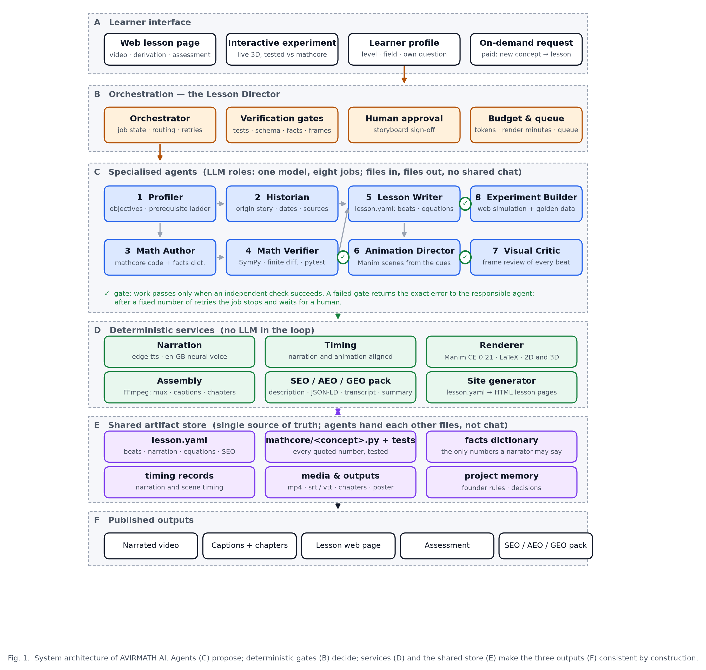
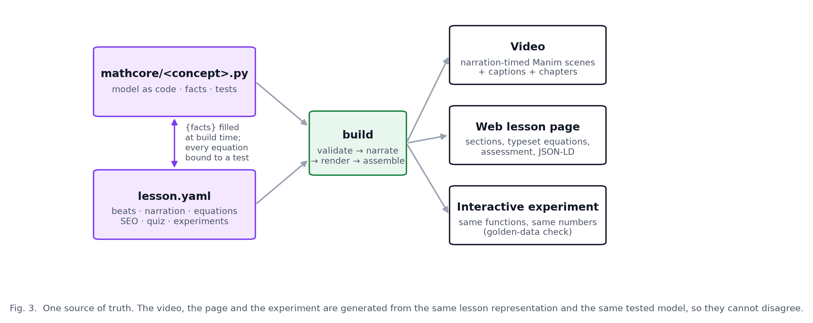

# AVIRMATH AI — System Architecture

**Open-source Ecosystem for the Mathematics behind AI**

| | |
|---|---|
| Document | Architecture reference for publication and for the project folder |
| Author | Gangadevi (founder, `@gangadeviai`) |
| Prepared with | A frontier large language model (LLM) agent, under the founder's direction |
| Version | 1.0, 6 October 2026 |
| Figures | `docs/figures/fig1_system_architecture.{pdf,svg,png}`, `fig3_single_source_of_truth.*`, `architecture_ieee.*` (vector PDF/SVG for the manuscript, 300-dpi PNG for Word and the web) |

---

## 1. Purpose and scope

AVIRMATH AI turns one mathematical concept behind artificial intelligence into a complete, consistent lesson: a story-led narrated video, a web lesson page with typeset derivations and an assessment, and an interactive experiment. All three are generated from a single lesson representation and a single, independently tested mathematics module, so they cannot contradict each other.

This document records the architecture as it stands after the Foundations phase (six lessons published). It lists every model, tool and library used, the multi-agent organisation, the orchestration structure that controls the agents, and, honestly, which parts are implemented today and which are the target design for the paid on-demand feature.

**Design principle.** *Agents propose; deterministic gates decide.* Language-model agents write mathematics, stories, lessons and animations, but nothing advances unless an independent, non-LLM check passes: unit tests, a schema validator, a facts dictionary, a source check, or a frame-level review.

---

## 2. System overview



*Figure 1. Layered system architecture. A: learner interface. B: orchestration and gates. C: eight specialised agent roles. D: deterministic services with no LLM in the loop. E: shared artifact store, the single source of truth. F: published outputs.*

The system has six layers:

| Layer | Contents | Responsibility |
|---|---|---|
| **A  Learner interface** | Web lesson page, interactive experiment, learner profile, on-demand request | Where a learner consumes a lesson or asks for a new one (paid). |
| **B  Orchestration** | Orchestrator (“Lesson Director”), verification gates, human approval, budget and queue | Owns job state, routes work between agents, enforces gates, bounds retries, stops for human sign-off, meters cost. |
| **C  Specialised agents** | Profiler, Historian, Math Author, Math Verifier, Lesson Writer, Animation Director, Visual Critic, Experiment Builder | The only components that use a large language model. Each is a role with its own tool set; they exchange files, never chat. |
| **D  Deterministic services** | Narration, renderer, assembly, SEO/AEO/GEO pack, site generator | Reproducible transformations of the artifacts; no model is consulted. |
| **E  Shared artifact store** | `lesson.yaml`, `mathcore/<concept>.py` + tests, facts dictionary, timing records, media, project memory | Single source of truth for every lesson. |
| **F  Published outputs** | Narrated video, captions and chapters, lesson web page, assessment, SEO/AEO/GEO pack | What learners and search engines receive. |

---

## 3. Models used

| Model | Provider / runtime | Where it is used | Notes |
|---|---|---|---|
| **Frontier large language model (LLM)** | Commercial model, accessed through an agentic coding runtime (file tools, shell, browser) | Every agent role in layer C (Profiler, Historian, Math Author, Math Verifier, Lesson Writer, Animation Director, Visual Critic, Experiment Builder) and the orchestration decisions | One model, eight roles. Roles are separated by prompt, tool access and the artifact they own, not by different models. The Visual Critic uses the model's image input to inspect rendered frames. |
| **en-GB-SoniaNeural** | Microsoft neural text-to-speech, accessed through `edge-tts` | Narration service (layer D) | Female British English voice chosen by the founder; speaking rate +10 to +12 %. |
| **Mathematical models in `mathcore`** | Deterministic Python (NumPy, SymPy) | Every number spoken, typeset or simulated | Not learned models. Each lesson ships its own small model, for example the gradient-descent landscape f(x, y) = x² + 3y², a two-layer network for backpropagation, a 20-dimensional ratings matrix for the matrices lesson, synthetic credit data for logistic regression. |

No image-generation, video-generation or voice-cloning models are used. Every frame is rendered programmatically from code, which is what makes frame-level verification possible.

---

## 4. Tools and libraries

### 4.1 Runtime and mathematics

| Tool | Version | Role |
|---|---|---|
| Python | 3.13.15 (virtual environment managed by `uv`) | Runtime for mathcore, lesson loader, pipeline and renderer. System Python 3.14 is not used because Manim has no wheels for it. |
| NumPy | 2.5.3 | Numerical core of every mathematics module. |
| SymPy | 1.14.0 | Symbolic derivatives used by the Math Verifier to check hand-written gradients. |
| pytest | current | 125 tests across seven test modules; the hard gate before any number may be quoted. |
| PyYAML | 6.0.3 | Lesson files (`lesson.yaml`). |
| jsonschema | 4.26.0 | Validates every lesson against `src/avirmath/lesson/schema.json`. |

### 4.2 Video production

| Tool | Version | Role |
|---|---|---|
| Manim Community Edition | 0.21.0 | 2D and true 3D animation (`ThreeDScene` surfaces for gradient landscapes, loss surfaces, transformations). |
| MiKTeX (LaTeX, dvisvgm) | 25.12 | Typesets every equation in the video. Must be invoked from the venv's own interpreter; running Manim through `uv run` breaks dvisvgm on Windows. |
| edge-tts | 7.2.8 | Neural narration. |
| FFmpeg (bundled) | imageio-ffmpeg 0.6.0 | Video assembly, loudness normalisation, muxing, captions, chapter metadata, logo overlay. |
| PyAV | 18.1.0 | Poster images. |
| Pillow | 12.3.0 | Poster and branding assets. |
| matplotlib | 3.11.2 | Publication figures in this document. |
| Space Grotesk, Outfit, Sora (fonts) | — | Brand typography; the logo wordmark uses Space Grotesk. |

### 4.3 Web

| Tool | Version | Role |
|---|---|---|
| Static site generator (`web/build_site.py`) | project code | Builds the home page and one page per lesson from the lesson files. |
| KaTeX | 0.16.9 | Typesets the same equations on the web page. |
| Three.js | 0.160.0 | Live 3D experiments in the browser. |
| Node.js | 24.18.0 | Front-end tooling and experiment tests. |
| Design system | Project design tokens | Light, Swiss-minimal tokens: Inter, Source Serif 4, Space Grotesk; primary #2563EB. |

### 4.4 Authoring environment

The agent roles run inside an LLM agent runtime (file tools, shell, browser for visual checks) and follow a written set of house rules covering pedagogy, visual style and production standards. The rules are part of the private pipeline. The Historian role checks people, dates and industry claims against primary sources.

---

## 5. The multi-agent system

One orchestrator and eight specialised agent roles. Each role owns one artifact and must pass a gate before its work is accepted. Roles never share a conversation; they hand each other files.

| # | Role | Owns |
|---|---|---|
| 0 | **Orchestrator** ("Lesson Director") | The job: routing, retries, approval requests. Never writes content. |
| 1 | **Profiler** | Learning objectives and the prerequisite ladder for the learner's level and field. |
| 2 | **Historian** | Real-world uses and sources for every claim. |
| 3 | **Math Author** | The mathematics as runnable code, with the facts a lesson may quote. |
| 4 | **Math Verifier** | The tests that try to break that code (125 today). |
| 5 | **Lesson Writer** | `lessons/<id>/lesson.yaml`: chapters, narration, equations, quiz, SEO/AEO/GEO block. |
| 6 | **Animation Director** | The animated scenes for each chapter. |
| 7 | **Visual Critic** | The frame-by-frame review of the rendered scenes. |
| 8 | **Experiment Builder** | The interactive experiment, checked against the same mathematics. |

**Independence is the point.** The Verifier and the Critic catch errors precisely because they did not produce the work they check.

---

## 6. Orchestration structure

A rule-based orchestrator moves every lesson through fixed verification gates: the mathematics tests must pass, the lesson file must validate with every placeholder resolved and every equation's test present, the founder must approve the storyboard, the animation must fit its narration, and every frame must pass visual review. A failed gate returns the exact error to the responsible role; after three failures the job stops for a person. The gates are deterministic programs, so a passing lesson is reproducible. The detailed job state machine, control rules and the timing contract between narration and animation are documented in the private repository.

---

## 7. Single source of truth



*Figure 3. The lesson file and the tested mathematics module generate the video, the web page and the experiment. Numbers flow one way, from tested code into prose.*

Two files define a lesson:

- **`mathcore/<concept>.py`** holds the concept as runnable code plus a `lesson_facts()` function. Its tests are the only authority for every number.
- **`lessons/<id>/lesson.yaml`** holds the chapters and beats, the narration with `{fact}` placeholders, the equations (each bound to a named test through `checked_by`), the animation cues, the quiz and the SEO/AEO/GEO block.

The loader validates the schema, fills every placeholder from the facts dictionary, and refuses to build if an equation's test does not exist. The video, the page and the experiment are then generated from the same filled lesson, so they cannot disagree.

---

## 7a. Five-layer workflow view (IEEE layout)


*Figure 4. The same system arranged as five horizontal layers in the IEEE Transactions convention: data preprocessing, orchestration and reasoning, core models and compute, governance and execution loop, downstream output and safety. Solid arrows are the forward flow; dotted arrows are the two bounded feedback loops. Source: `docs/figures/architecture_ieee.mmd` (Mermaid), exported to SVG, PDF and PNG.*

---

## 8. Implementation status

| Component | Status (6 Oct 2026) |
|---|---|
| Mathematics modules and tests | **Implemented.** Seven modules, 125 passing tests. |
| Lesson schema, loader, facts binding, `checked_by` check | **Implemented.** |
| Video production pipeline: narration, animation, rendering, captions, chapters, SEO pack | **Implemented** (private repository). |
| Static site generator and six lesson pages | **Implemented** (private repository; the generated site is public). |
| Eight agent roles and the gates | **Implemented as roles executed by the LLM agent inside its runtime**, under the founder's direction, one lesson at a time. The gates are real programs and were enforced for every lesson. |
| Orchestrator as an autonomous service (job store, queue, budget meter, approval inbox) | **Target.** Today the founder and the LLM agent session play this role by hand. Required for the paid on-demand feature. |
| Interactive experiments on the generated pages | **Partially implemented.** Three.js experiment exists in the design preview; wiring into every generated lesson page is pending. |
| Learner profiles, accounts, payments, hosting | **Not started.** Business decision on free versus paid first release is open. |

### Published lessons

| # | Lesson | Mathematics module |
|---|---|---|
| 1 | Gradient descent (Cauchy, 1847 → Stanford, 1960 → today) | `gradient_descent.py`, `adaptive_filter.py` |
| 2 | Backpropagation | `backprop.py` |
| 3 | Vectors and the dot product | `vectors.py` |
| 4 | Matrices as transformations | `matrices.py` |
| 5 | Softmax and cross-entropy | `softmax.py` |
| 6 | Linear and logistic regression | `regression.py` |

Each lesson ships as a 720p video with SRT and VTT captions, a chapter file and an SEO/AEO/GEO pack (captions and packs are in `results/`).

---

## 9. Repository layout

This public repository:

```
avirmath-ai-showcase/
├─ README.md, RESULTS.md, DECISIONS.md, DATASETS.md
├─ LICENSE (Apache-2.0, code) · LICENSE-CONTENT.md (CC BY-NC 4.0, lessons)
├─ docs/                           this document, the plain-language explainer, figures
├─ lessons/<id>/lesson.yaml        one lesson file per concept; CATALOG.md lists the 21 topics
├─ src/avirmath/mathcore/          tested mathematics, one module per concept, lesson_facts()
├─ src/avirmath/lesson/            schema.json and loader (validation, facts binding, checked_by)
├─ tests/                          125 pytest tests
├─ data/                           the three UCI datasets modelled on screen
├─ results/<id>/                   captions, chapters, descriptions and AI summaries per lesson
└─ thumbnails/                     published video thumbnails
```

The production pipeline (narration, animation, rendering, site generation) lives in a private repository.

---

## 10. Reproducibility

From this repository:

```bash
python -m venv .venv
.venv/Scripts/pip install -e ".[test]"
python -m pytest -q
```

Every number quoted in a lesson can be regenerated with `lesson_facts()` from the corresponding module, and every lesson file can be validated with `avirmath.lesson.loader.load_lesson`. The figures are generated from code, so they can be revised for a journal's style requirements (size, font, greyscale) without redrawing.

