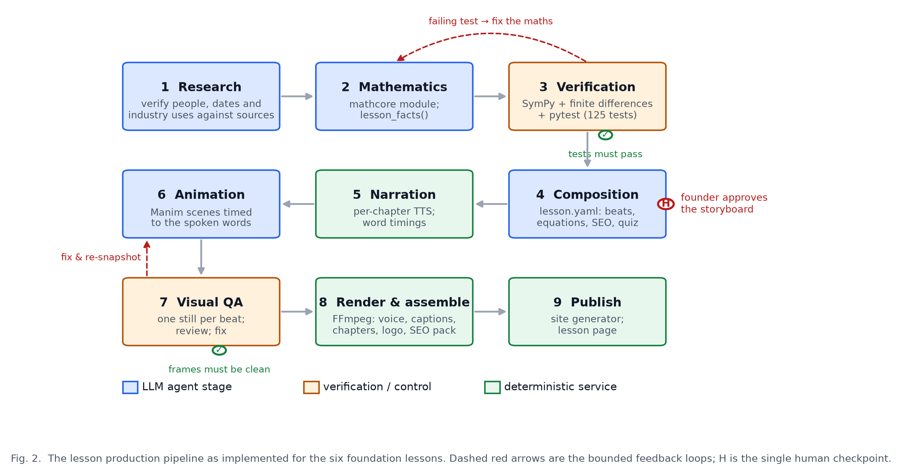

# AVIRMATH AI — System Architecture

**Open-source Ecosystem for the Mathematics behind AI**

| | |
|---|---|
| Document | Architecture reference for publication and for the project folder |
| Author | Gangadevi (founder, `@gangadeviai`) |
| Prepared with | A frontier large language model (LLM) agent, under the founder's direction |
| Version | 1.0, 6 October 2026 |
| Figures | `docs/figures/fig1_system_architecture.{pdf,svg,png}`, `fig2_lesson_pipeline.*`, `fig3_single_source_of_truth.*` (vector PDF/SVG for the manuscript, 300-dpi PNG for Word and the web) |

---

## 1. Purpose and scope

AVIRMATH AI turns one mathematical concept behind artificial intelligence into a complete, consistent lesson: a story-led narrated video, a web lesson page with typeset derivations and an assessment, and an interactive experiment. All three are generated from a single lesson representation and a single, independently tested mathematics module, so they cannot contradict each other.

This document records the architecture as it stands after the Foundations phase (six lessons published). It lists every model, tool and library used, the multi-agent organisation, the orchestration structure that controls the agents, and, honestly, which parts are implemented today and which are the target design for the paid on-demand feature.

**Design principle.** *Agents propose; deterministic gates decide.* Language-model agents write mathematics, stories, lessons and animations, but nothing advances unless an independent, non-LLM check passes: unit tests, a schema validator, a facts dictionary, a source check, or a frame-level review.

---

## 2. System overview


*Figure 1. Layered system architecture. A: learner interface. B: orchestration and gates. C: eight specialised agent roles. D: deterministic services with no LLM in the loop. E: shared artifact store, the single source of truth. F: published outputs.*

The system has six layers:

| Layer | Contents | Responsibility |
|---|---|---|
| **A  Learner interface** | Web lesson page, interactive experiment, learner profile, on-demand request | Where a learner consumes a lesson or asks for a new one (paid). |
| **B  Orchestration** | Orchestrator (“Lesson Director”), verification gates, human approval, budget and queue | Owns job state, routes work between agents, enforces gates, bounds retries, stops for human sign-off, meters cost. |
| **C  Specialised agents** | Profiler, Historian, Math Author, Math Verifier, Lesson Writer, Animation Director, Visual Critic, Experiment Builder | The only components that use a large language model. Each is a role with its own tool set; they exchange files, never chat. |
| **D  Deterministic services** | Narration, sync engine, renderer, assembly, SEO/AEO/GEO pack, site generator | Reproducible transformations of the artifacts; no model is consulted. |
| **E  Shared artifact store** | `lesson.yaml`, `mathcore/<concept>.py` + tests, facts dictionary, timing records, media, project memory | Single source of truth for every lesson. |
| **F  Published outputs** | Narrated video, captions and chapters, lesson web page, assessment, SEO/AEO/GEO pack | What learners and search engines receive. |

---

## 3. Models used

| Model | Provider / runtime | Where it is used | Notes |
|---|---|---|---|
| **Frontier large language model (LLM)** | Commercial model, accessed through an agentic coding runtime (file tools, shell, browser) | Every agent role in layer C (Profiler, Historian, Math Author, Math Verifier, Lesson Writer, Animation Director, Visual Critic, Experiment Builder) and the orchestration decisions | One model, eight roles. Roles are separated by prompt, tool access and the artifact they own, not by different models. The Visual Critic uses the model's image input to inspect rendered frames. |
| **en-GB-SoniaNeural** | Microsoft neural text-to-speech, accessed through `edge-tts` | Narration service (layer D) | Female British English voice chosen by the founder; speaking rate +10 to +12 %. Returns word-level timings used by the sync engine. |
| **Mathematical models in `mathcore`** | Deterministic Python (NumPy, SymPy) | Every number spoken, typeset or simulated | Not learned models. Each lesson ships its own small model, for example the gradient-descent landscape f(x, y) = x² + 3y², a two-layer network for backpropagation, a 20-dimensional ratings matrix for the matrices lesson, synthetic credit data for logistic regression. |

No image-generation, video-generation or voice-cloning models are used. Every frame is rendered programmatically from code, which is what makes frame-level verification possible.

---

## 4. Tools and libraries

### 4.1 Runtime and mathematics

| Tool | Version | Role |
|---|---|---|
| Python | 3.13.15 (virtual environment managed by `uv`) | Runtime for mathcore, lesson loader, pipeline and renderer. System Python 3.14 is not used because Manim has no wheels for it. |
| NumPy | 2.5.3 | Numerical core of every mathematics module. |
| SymPy | 1.14.0 | Symbolic derivatives used by the Math Verifier to check hand-written gradients. |
| pytest | current | 125 tests across seven test modules; the hard gate before any number may be quoted. |
| PyYAML | 6.0.3 | Lesson files (`lesson.yaml`). |
| jsonschema | 4.26.0 | Validates every lesson against `src/avirmath/lesson/schema.json`. |

### 4.2 Video production

| Tool | Version | Role |
|---|---|---|
| Manim Community Edition | 0.21.0 | 2D and true 3D animation (`ThreeDScene` surfaces for gradient landscapes, loss surfaces, transformations). |
| MiKTeX (LaTeX, dvisvgm) | 25.12 | Typesets every equation in the video. Must be invoked from the venv's own interpreter; running Manim through `uv run` breaks dvisvgm on Windows. |
| edge-tts | 7.2.8 | Neural narration with word timings. |
| FFmpeg (bundled) | imageio-ffmpeg 0.6.0 | Per-beat audio trimming and delay, loudness normalisation, muxing, captions, chapter metadata, logo overlay. |
| PyAV | 18.1.0 | Frame extraction for QA stills and poster images. |
| Pillow | 12.3.0 | Poster and branding assets. |
| matplotlib | 3.11.2 | Publication figures in this document. |
| Space Grotesk, Outfit, Sora (fonts) | — | Brand typography; the logo wordmark uses Space Grotesk. |

### 4.3 Web

| Tool | Version | Role |
|---|---|---|
| Static site generator (`web/build_site.py`) | project code | Builds the home page and one page per lesson from the lesson files. |
| KaTeX | 0.16.9 | Typesets the same equations on the web page. |
| Three.js | 0.160.0 | Live 3D experiments in the browser. |
| Node.js | 24.18.0 | Front-end tooling and experiment tests. |
| Design system | ui-ux-pro-max skill output (`design-system/avirmath-ai/MASTER.md`) | Light, Swiss-minimal tokens: Inter, Source Serif 4, Space Grotesk; primary #2563EB. |

### 4.4 Authoring environment

| Tool | Role |
|---|---|
| LLM agent runtime (desktop) | File tools, shell, browser pane for visual QA, persistent project memory. |
| `avirmathai` skill | House rules the agents follow: approval before building, history-grounded stories, mathematician-grade examples, 3D for gradients, step-by-step working, British narration, per-learner profiles. |
| Design skills (`ui-ux-pro-max`, `design-system`, `brand`) | Design tokens and review checklists for the site and the logo. |
| Wikipedia and primary sources | Historian's source check for people, dates and industry claims. |

---

## 5. The multi-agent system

One orchestrator and eight specialised agents. Each agent is a role with a fixed input artifact, a fixed output artifact, a restricted tool set, and a gate it must pass. Agents never share a conversation; they hand each other files through the shared store (Figure 1, layer E).

| # | Agent | Input | Output (artifact it owns) | Tools it may use | Gate before its output is accepted |
|---|---|---|---|---|---|
| 0 | **Orchestrator** (“Lesson Director”) | Learner request: topic, level, field, own question | Job record, routing decisions, retry counts, approval requests | Job state store, queue, gate results, budget meter, approval inbox. Never writes content. | — |
| 1 | **Profiler** | Learner request, concept graph, catalogue | Learning objectives and prerequisite ladder | Concept graph, catalogue (`lessons/CATALOG.md`), learner-profile store | Objectives reference catalogue concepts only |
| 2 | **Historian** | Objectives | Origin story, dated events, real industry use, with sources | Web search, page fetch, citation store | Every claim has a source; dates cross-checked |
| 3 | **Math Author** | Objectives | `mathcore/<concept>.py` with a `lesson_facts()` dictionary | Python sandbox, NumPy, SymPy | Hands over to the Verifier; cannot self-approve |
| 4 | **Math Verifier** | The Math Author's code only (never its reasoning) | `tests/test_<concept>.py`; pass/fail report | pytest, SymPy symbolic differentiation, finite-difference gradient checker | All tests pass (125 today) |
| 5 | **Lesson Writer** | Story, facts dictionary, objectives | `lessons/<id>/lesson.yaml`: chapters, beats, narration, equations, animation cues, quiz, SEO/AEO/GEO block | Lesson schema validator, facts dictionary, `avirmathai` skill | Schema valid; every `{placeholder}` resolves to a fact; every equation names a `checked_by` test that exists; founder approves the storyboard |
| 6 | **Animation Director** | `lesson.yaml` cues, word timings | Manim scene classes (`video/scenes/<id>.py`) | Manim, style module, scene library, snapshot renderer (`--snap`) | Every beat ends within its narrated window (no overrun) |
| 7 | **Visual Critic** | One still per beat | Defect list or clean report | Frame sampler, image input (“watch it muted”) | No overlaps, clipping, off-palette colours, or logo-corner intrusions |
| 8 | **Experiment Builder** | `lesson.yaml` experiment spec, mathcore | Browser simulation (Three.js) and golden data | Reference-data exporter from mathcore, test runner | Simulation reproduces mathcore numbers within tolerance |

**Independence is the point.** The Verifier and the Critic catch errors precisely because they did not produce the work they check. Least privilege applies: only the Historian reaches the web, only the mathematics agents execute code, and only the orchestrator can publish.

---

## 6. Orchestration structure



*Figure 2. The nine-stage pipeline as run for the six foundation lessons. Blue stages are agent work, orange are verification and control, green are deterministic services. Dashed red arrows are bounded feedback loops. H marks the single human checkpoint.*

### 6.1 Job state machine

A lesson job moves through nine states. The orchestrator advances a job only when the stage's gate reports success.

| Stage | Who | Gate | On failure |
|---|---|---|---|
| 1 Research | Historian | Sources present and consistent | Re-research, max 3 attempts |
| 2 Mathematics | Math Author | — (hands to 3) | — |
| 3 Verification | Math Verifier | `pytest` all green | Exact failing assertion returned to the Math Author; max 3 attempts |
| 4 Composition | Lesson Writer | Schema valid, facts resolved, `checked_by` tests exist | Validator message returned to the Writer |
| **H** Storyboard approval | Founder | Approved | Writer revises; job waits |
| 5 Narration | Service | Audio and `timings.json` produced for every chapter | Service error → stop |
| 6 Animation | Animation Director | Each beat's `actual/<Scene>.json` within its narrated window | Overrun report returned to the Director |
| 7 Visual QA | Visual Critic | No defects in any beat still | Defect list returned to the Director; re-snapshot |
| 8 Render and assemble | Service | Output file exists, duration matches narration | Service error → stop |
| 9 Publish | Service | Site builds, page has video, captions, poster | Service error → stop |

### 6.2 Control rules

1. **Order and parallelism.** The Historian and the Math Author run concurrently; the Lesson Writer waits for both. The Experiment Builder runs in parallel with the Animation Director once the storyboard is approved.
2. **Hard gates.** No agent can overrule a gate. The gates are deterministic programs, so a passing lesson is reproducible.
3. **Bounded feedback loops.** A failed gate returns the exact error to the responsible agent. After three failures the job stops and is flagged for a person. This bounds cost and prevents endless self-correction.
4. **Shared artifacts, not chat.** Agents communicate through `lesson.yaml`, the mathematics module, the facts dictionary and the timing records. This is what keeps story, simulation and video consistent, and it makes every hand-off inspectable.
5. **One human checkpoint.** The storyboard stops for the founder's sign-off before the expensive animation and render stages. Six lessons were approved this way; the first pilot was rejected once (story and theming) and re-planned before any animation was rendered.
6. **Budget and reuse.** Each job has a token and render-minute budget. A verified mathematics module is reused across learners: the same mathematics can be given a different story, example and depth, which is what makes personalisation affordable.

### 6.3 Timing contract between narration and animation

The sync engine gives every beat a spoken window. Narration is synthesised per chapter, word timings recover the beat boundaries, and each Manim scene declares `with self.beat(id)` blocks that may `wait_for("phrase")` on a cue word. At assembly, audio is sliced per beat (`atrim` + `adelay`), so a small animation overrun is absorbed rather than drifting through the rest of the video. The build records the actual start of every beat so the Visual Critic and the overrun gate check real frames, not estimates.

---

## 7. Single source of truth


*Figure 3. The lesson file and the tested mathematics module generate the video, the web page and the experiment. Numbers flow one way, from tested code into prose.*

Two files define a lesson:

- **`mathcore/<concept>.py`** holds the concept as runnable code plus a `lesson_facts()` function. Its tests are the only authority for every number.
- **`lessons/<id>/lesson.yaml`** holds the chapters and beats, the narration with `{fact}` placeholders, the equations (each bound to a named test through `checked_by`), the animation cues, the quiz and the SEO/AEO/GEO block.

The loader validates the schema, fills every placeholder from the facts dictionary, and refuses to build if an equation's test does not exist. The video, the page and the experiment are then generated from the same filled lesson, so they cannot disagree.

---

## 7a. Five-layer workflow view (IEEE layout)


*Figure 4. The same system arranged as five horizontal layers in the IEEE Transactions convention: data preprocessing, orchestration and reasoning, core models and compute, governance and execution loop, downstream output and safety. Solid arrows are the forward flow; dotted arrows are the two bounded feedback loops. Source: `docs/figures/architecture_ieee.mmd` (Mermaid), exported to SVG, PDF and PNG.*

---

## 8. Implementation status

| Component | Status (6 Oct 2026) |
|---|---|
| Mathematics modules and tests | **Implemented.** Seven modules, 125 passing tests. |
| Lesson schema, loader, facts binding, `checked_by` check | **Implemented.** |
| Narration, sync engine, snapshot QA, renderer, assembly, branding overlay, captions, chapters, SEO pack | **Implemented** (`src/avirmath/video/`). |
| Static site generator and six lesson pages | **Implemented** (`web/build_site.py` → `web/site/`). |
| Eight agent roles and the gates | **Implemented as roles executed by the LLM agent inside its runtime**, under the founder's direction, one lesson at a time. The gates are real programs and were enforced for every lesson. |
| Orchestrator as an autonomous service (job store, queue, budget meter, approval inbox) | **Target.** Today the founder and the LLM agent session play this role by hand. Required for the paid on-demand feature. |
| Interactive experiments on the generated pages | **Partially implemented.** Three.js experiment exists in the design preview; wiring into every generated lesson page is pending. |
| Learner profiles, accounts, payments, hosting | **Not started.** Business decision on free versus paid first release is open. |

### Published lessons

| # | Lesson | Mathematics module | Output |
|---|---|---|---|
| 1 | Gradient descent (Cauchy, 1847 → Stanford, 1960 → today) | `gradient_descent.py`, `adaptive_filter.py` | `output/gradient-descent/v2-female-voice-logo/` |
| 2 | Backpropagation | `backprop.py` | `output/backpropagation/v1/` |
| 3 | Vectors and the dot product | `vectors.py` | `output/vectors-dot-product/v1/` |
| 4 | Matrices as transformations | `matrices.py` | `output/matrices-transformations/v1/` |
| 5 | Softmax and cross-entropy | `softmax.py` | `output/softmax-cross-entropy/v1/` |
| 6 | Linear and logistic regression | `regression.py` | `output/linear-logistic-regression/v1/` |

Each output folder contains the 720p24 video, SRT and VTT captions, a chapter file and the SEO/AEO/GEO pack.

---

## 9. Repository layout

```
Avirmath AI/
├─ skills/avirmathai/              house rules, pedagogy and Manim references, scene template
├─ ARCHITECTURE.md                 short agent design note (superseded by this document)
├─ PLAN.md                         product plan and phases
├─ branding.yaml                   logo and handle placement rules
├─ design-system/avirmath-ai/      design tokens from the ui-ux-pro-max skill
├─ docs/
│  ├─ AVIRMATH_AI_Architecture.md  this document
│  └─ figures/                     make_figures.py and fig1–fig3 (pdf, svg, png)
├─ lessons/<id>/lesson.yaml        one lesson file per concept; CATALOG.md lists 21 planned topics
├─ src/avirmath/
│  ├─ mathcore/                    tested mathematics, one module per concept
│  ├─ lesson/                      schema.json and loader (validation, facts binding)
│  └─ video/                       narrate, build, branding, seo, style, scenes/<id>.py
├─ tests/                          125 pytest tests
├─ web/build_site.py → web/site/   static site (home + lessons + media)
└─ output/<id>/<version>/          published videos and packs
```

Project source (Python, HTML, JavaScript, excluding generated site) is about 7,000 lines.

---

## 10. Reproducibility

All commands run from the project root with the project's own interpreter.

```bash
.venv\Scripts\python.exe -m pytest -q
```

```bash
.venv\Scripts\python.exe -m avirmath.video.build gradient-descent --quality sample --snap
```

```bash
.venv\Scripts\python.exe web\build_site.py
```

```bash
.venv\Scripts\python.exe docs\figures\make_figures.py
```

The figures are regenerated from code, so they can be revised for a journal's style requirements (size, font, greyscale) without redrawing.
