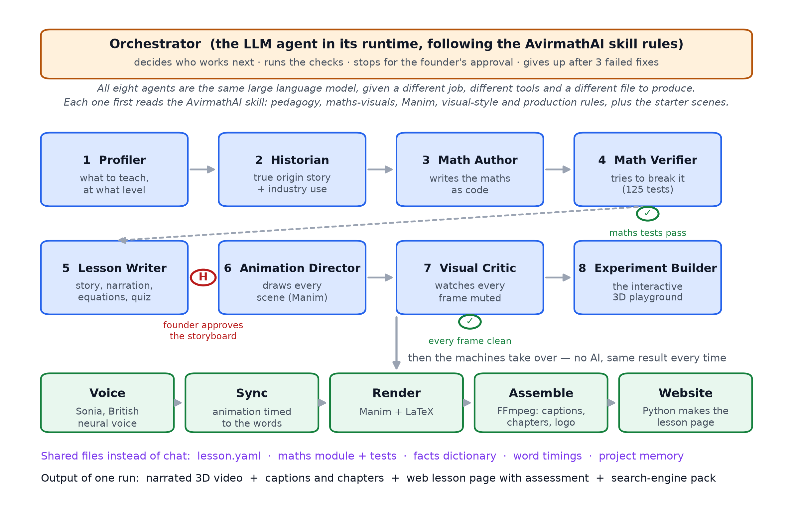
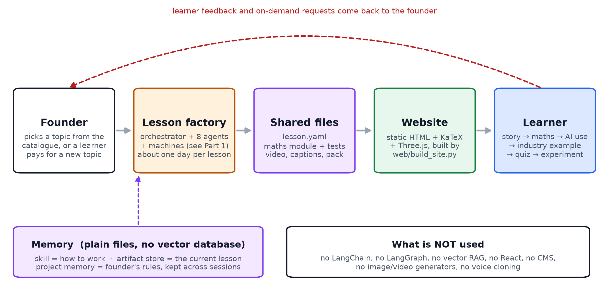

# AVIRMATH AI, explained simply

*How the lessons and videos are made, and how the whole thing works end to end. Written for someone who has never seen the product. 11 October 2026.*

---

## The one-paragraph version

AVIRMATH AI is a factory for maths lessons. You pick a topic from the catalogue, for example "gradient descent". A team of AI workers, all run by the same AI model, research the true history, write the maths as code, test that code, write the story and the narration, draw every scene, and check every frame. Then ordinary software (no AI) adds a British voice, times the animation to the words, stitches the video together, and builds the web page. Everything comes from one lesson file and one tested maths file, so the video, the web page and the interactive playground always say the same thing.

---

## Straight answers to the usual questions

| Question | Answer |
|---|---|
| How many AI agents? | **Nine roles: one Orchestrator and eight workers.** Profiler, Historian, Math Author, Math Verifier, Lesson Writer, Animation Director, Visual Critic, Experiment Builder. |
| Are they different AIs? | **No. One model plays every role**: a single frontier large language model, running inside an agent runtime with file, shell and browser tools. Each role gets a different job description, different tools and a different file it must produce. The Verifier and the Critic never see the work of the agent they are checking, which is why they catch mistakes. |
| What is the orchestration? | **Custom, rule-based.** The Orchestrator (the same model, following the AvirmathAI skill rules) decides who works next. It cannot move a job forward unless a hard check passes: the maths tests pass, the lesson file validates, every frame is clean, and the founder has approved the storyboard. A failed check sends the exact error back to the responsible worker. After three failed fixes the job stops and waits for a human. |
| LangChain or LangGraph? | **No.** Neither is used. The orchestration is the agent runtime's own tool-calling loop plus a Python pipeline with hard checks. |
| RAG (retrieval-augmented generation)? | **No vector database, no embedding search.** Retrieval is file-based: the agents read the skill files, the lesson file, the tested maths module and the memory files directly, and the Historian looks up sources on the web. |
| What kind of memory? | **Three kinds, all plain files.** (1) The *skill*: how to work, the house rules (see "The rulebook" below). (2) The *shared artifact store*: the current lesson's files, which the agents hand to each other instead of chatting. (3) *Project memory*: the founder's rules and decisions, kept across sessions by the agent runtime. No vector memory. |
| What models? | **One frontier large language model** for all thinking. **Microsoft's en-GB Sonia neural voice** (through edge-tts) for narration. Nothing else: no image generators, no video generators, no voice cloning. |
| What makes the pictures? | **Manim**, the Python animation library, with LaTeX for the equations. Every frame is drawn by code, which is why a Critic can check it. |
| What front-end software? | **Plain HTML, CSS and JavaScript**, generated by a Python script. KaTeX typesets the equations, Three.js runs the 3D experiments, fonts are Inter, Source Serif 4 and Space Grotesk. No React, no Next.js, no CMS. Any static web host can serve it. |
| What else is in the toolbox? | Python 3.13, NumPy and SymPy (maths), pytest (125 tests), FFmpeg (video assembly), MiKTeX (LaTeX), PyYAML and jsonschema (lesson file). |

---

## Part 1. How one lesson and its video are made

Think of it as a newsroom with eight desks and an editor.

1. **Profiler** decides what to teach and at what level: the objectives and what the learner must already know.
2. **Historian** finds the true origin story (who, when, why) and a real industry use, with sources. No invented anecdotes.
3. **Math Author** writes the maths as runnable code, plus a short "facts dictionary": the only numbers the lesson is allowed to quote.
4. **Math Verifier** tries to break that code with tests, symbolic derivatives and numerical checks. **Check 1: the tests must pass.** If not, the exact failure goes back to the Author.
5. **Lesson Writer** writes the lesson file: the story, the narration, the equations (each tied to a named test), the animation cues, the quiz and the search-engine text. **The founder reads this storyboard and approves it** before any expensive animation starts.
6. **Animation Director** turns the cues into Manim scenes, timed to the narration.
7. **Visual Critic** looks at one still per beat, "watching it muted", for overlaps, clipping and wrong colours. **Check 2: every frame must be clean.** Defects go back to the Director.
8. **Experiment Builder** builds the interactive 3D playground from the same maths code and checks it gives the same numbers.

Then the machines take over, with no AI involved, so the result is the same every time:

- **Voice**: Sonia reads the narration chapter by chapter and reports when each word is spoken.
- **Sync**: each animation beat is stretched to exactly its spoken words.
- **Render**: Manim and LaTeX draw the frames.
- **Assemble**: FFmpeg joins voice and video, adds captions, chapters and the logo, and writes the search-engine pack.
- **Website**: a Python script turns the lesson file into the lesson page.

**What one run produces:** a narrated 3D video, captions and chapters, a web lesson page with assessment, and a search-engine pack. Six lessons have been made this way so far.

---

## The rulebook: where the AvirmathAI skill fits

The skill is the knowledge the agents were trained on before any lesson was made. It is not a model and not a database. It is about 1,200 lines of written rules and starter code in `skills/avirmathai/`, and it is the first thing every agent reads. In the architecture it is the **procedural memory**: it tells each role how to do its job well and what counts as a mistake.

| Skill file | What it holds | Which agent reads it |
|---|---|---|
| `SKILL.md` | The working order and house rules: approval before building, story first, maths at the centre, real industry examples, British narration, step-by-step working | **Orchestrator** (the order of work), and every agent for the house rules |
| `references/pedagogy.md` | How to break a topic into micro-lessons; a five-step method for building and stress-testing an analogy | **Profiler** (objectives, prerequisite ladder) and **Lesson Writer** (story, analogies) |
| `references/math-visuals.md` | How to draw vectors, matrices, the dot product, softmax, gradients, attention; where a tempting picture is subtly wrong | **Animation Director** (what to draw) and **Visual Critic** (what counts as a wrong picture) |
| `references/manim-ce.md` | Manim set-up, command line, camera moves, 3D, likely errors; differences from `manimgl` | **Animation Director** |
| `references/visual-style.md` | "Watch it muted" turned into rules for colour, camera and text grouping, with a review checklist | **Visual Critic** (the checklist) and **Animation Director** |
| `references/production.md` | Recording, Audacity clean-up, DaVinci Resolve assembly, music, YouTube export | Written for a human editor. In the built pipeline this stage is automated by the Voice, Sync and Assemble machines, so it is used only when a lesson is finished by hand |
| `assets/avirmath_style.py` | The colour palette and drawing helpers | **Animation Director**; the production style module `video/style.py` grew out of it |
| `assets/scene_template.py` | Three starter scenes: dot product as a shadow, softmax with temperature, a matrix moving space | **Animation Director**, as the pattern every new scene copies |
| `assets/storyboard_template.md` | The storyboard layout the founder approves | **Lesson Writer** writes it; the **founder** approves it |

So when the diagram says "following the AvirmathAI skill rules", it means these nine files. The design skills (`ui-ux-pro-max`, `design-system`, `brand`) play the same role for the website and the logo.

---

## Part 2. The whole workflow, end to end

1. **The founder** picks the next topic from the 21-topic catalogue. Later, a learner will be able to pay for a topic that is not in the catalogue yet; that request goes through the same factory.
2. **The lesson factory** (Part 1) makes the lesson. The founder approves the storyboard once, in the middle. One lesson takes about a day on an ordinary laptop.
3. **The shared files** are the product's memory of that lesson: the lesson file, the maths module and its tests, the video, the captions and the search pack. Nothing is stored in a chat log.
4. **The website** is rebuilt from those files by one script. It is a plain static site, so it is cheap to host and fast to load.
5. **The learner** opens a lesson and follows the fixed flow: story, then the maths, then where AI uses it, then a real industry example, then the quiz and the experiment.
6. **Feedback** and on-demand requests come back to the founder, who decides what to build next.

---

## What is deliberately not used, and why

| Not used | Why |
|---|---|
| LangChain, LangGraph, CrewAI or similar | The orchestration needs are small and specific: nine roles, four hard checks, one human approval. Plain rules plus a Python pipeline are simpler to audit and cannot be bypassed by a model. |
| Vector database / embedding RAG | Each lesson's knowledge fits in a few files that are read directly. The maths must come from tested code, not from retrieved text. |
| Image or video generation models | Generated pictures cannot be verified. Code-drawn frames can be checked frame by frame, and the equations are guaranteed correct. |
| Voice cloning | A free, consistent neural voice was chosen; cloning would need a paid service. |
| React, Next.js, a CMS | A static site generated from the lesson files is enough, and it keeps the page in step with the video automatically. |

---

## Where things live

- `docs/AVIRMATH_AI_Explained_Simply.md`: this document.
- `docs/figures/simple1_lesson_and_video.*` and `simple2_whole_workflow.*`: the two diagrams above (PDF, SVG, PNG).
- `docs/AVIRMATH_AI_Architecture.md` and `.docx`: the detailed technical version with full tool versions and the per-agent tool table.
